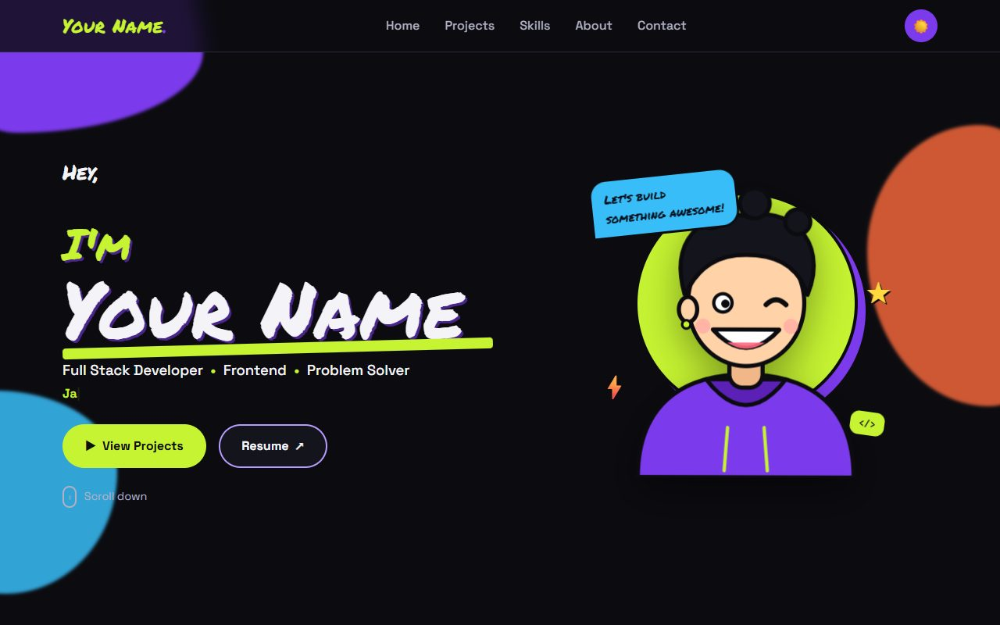
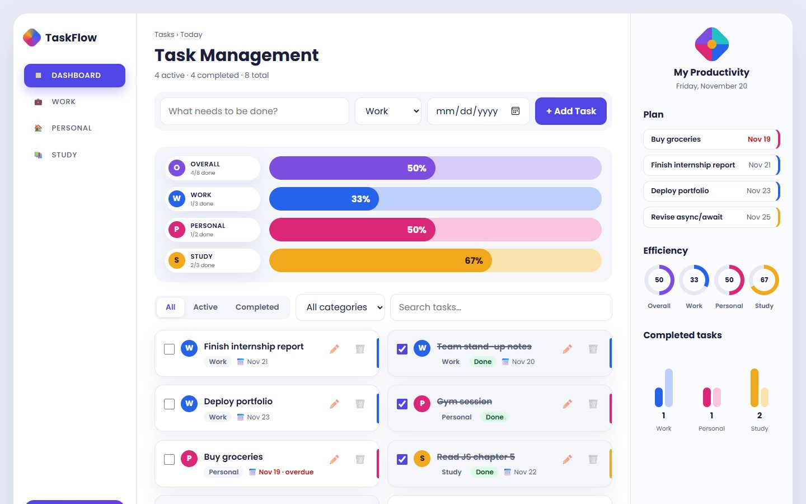
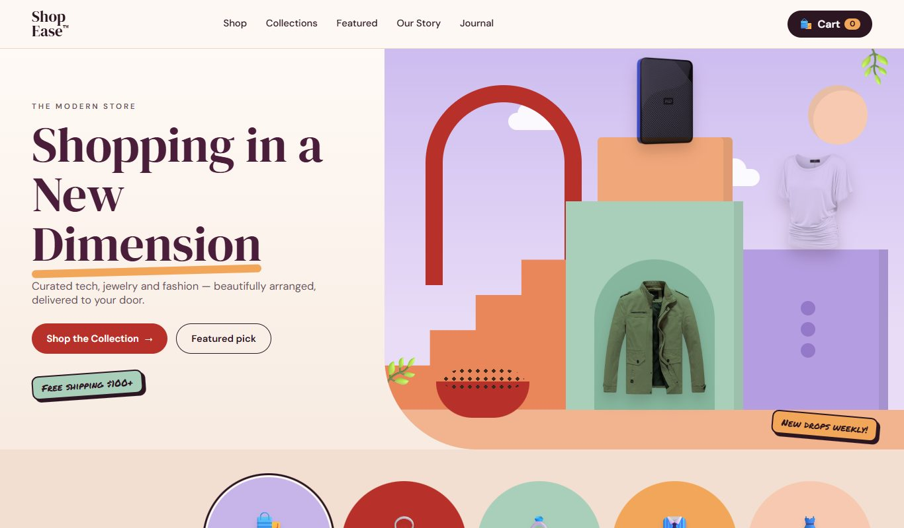

# Datheon Full Stack Web Development Internship

Four web projects built by **Peer Shah** for the Datheon Full Stack Web Development Internship, using vanilla HTML5, CSS3 and JavaScript (ES6+). No frameworks and no build step.

## Live demo

| Project | GitHub Pages | Vercel |
|---------|--------------|--------|
| Landing page (all projects) | [Open](https://peershah624372.github.io/Datheon_Full_Stack_Web_Development_Internship/) | [Open](https://datheon-full-stack-web-development-internship.vercel.app/) |
| Task 1 – Developer Portfolio | [Open](https://peershah624372.github.io/Datheon_Full_Stack_Web_Development_Internship/Task1-Portfolio/) | [Open](https://datheon-full-stack-web-development-internship.vercel.app/Task1-Portfolio/) |
| Task 2 – Task Manager | [Open](https://peershah624372.github.io/Datheon_Full_Stack_Web_Development_Internship/Task2-Task-Manager/) | [Open](https://datheon-full-stack-web-development-internship.vercel.app/Task2-Task-Manager/) |
| Task 3 – Weather App | [Open](https://peershah624372.github.io/Datheon_Full_Stack_Web_Development_Internship/Task3-Weather-App/) | [Open](https://datheon-full-stack-web-development-internship.vercel.app/Task3-Weather-App/) |
| Task 4 – E-Commerce Store | [Open](https://peershah624372.github.io/Datheon_Full_Stack_Web_Development_Internship/Task4-E-Commerce/) | [Open](https://datheon-full-stack-web-development-internship.vercel.app/Task4-E-Commerce/) |

> On **Vercel** the weather app uses OpenWeatherMap through a server-side proxy (the API key stays hidden). On **GitHub Pages**, which can't run server code, it uses Open-Meteo instead. Everything else is identical.

## Projects

| # | Project | Level | Highlights |
|---|---------|-------|------------|
| 1 | [Developer Portfolio](Task1-Portfolio/) | Beginner | Clean, modern design with an animated terminal hero, filterable project grid with modal popups, skills, experience/education timeline, web résumé + downloadable PDF, mobile-first Flexbox/Grid layout, dark/light theme (follows the system, choice saved), smooth scroll, hamburger menu, per-field form validation, skip link, keyboard focus handling, reduced-motion support |
| 2 | [Task Manager (CRUD)](Task2-Task-Manager/) | Beginner | Dashboard layout with category sidebar, progress bars, efficiency rings, completed-tasks chart and upcoming-deadline plan. Add/edit/delete, categories (Work/Personal/Study), due dates + overdue flag, All/Active/Completed filters, search, drag-and-drop or Alt + ↑/↓ reorder, edit title/category/date inline, undo for delete and "clear completed", sort by due date or A–Z, keyboard shortcuts (`/` search, `N` new task), `localStorage` persistence synced across tabs, completion animations |
| 3 | [Weather Forecast App](Task3-Weather-App/) | Intermediate | Widget dashboard: current weather, sunrise/sunset arc, hourly and 5-day forecast, precipitation, wind, humidity, pressure, UV index, air-quality gauge and alert banner. `fetch` + `async/await` + `try/catch`, loading spinner, request timeouts, invalid-city errors that keep the last result on screen, protection against out-of-order responses, recent searches, weather- and night-based themes, °C/°F (and km/h ↔ mph) remembered |
| 4 | [E-Commerce Store](Task4-E-Commerce/) | Intermediate | Architectural storefront design with arch-shaped collection filters, live hero scene and featured pick. FakeStoreAPI catalog, search, sort, slide-out cart with badge, quantity +/−, tax and shipping calculation, persistent cart synced across tabs, "added to cart" toast, simulated checkout with a validated delivery form and itemised receipt, focus-trapped drawer and modals, newsletter form |

## Screenshots

| Task 1 – Portfolio | Task 2 – Task Manager |
|---|---|
|  |  |
| **Task 3 – Weather App** | **Task 4 – E-Commerce Store** |
|  |  |

Mobile views: [portfolio](screenshots/task1-portfolio-mobile.jpg) · [store](screenshots/task4-ecommerce-mobile.jpg)

## Folder structure

```
.
├── index.html              # landing page showcasing all projects
├── repo-link.js            # builds the "Source code" links to this GitHub repo
├── api/owm.js              # Vercel serverless proxy that keeps the OpenWeatherMap key on the server
├── screenshots/            # project screenshots used by the README and landing page
├── Task1-Portfolio/        # index.html, css/style.css, js/script.js, resume.html, assets/ (résumé PDF + project art)
├── Task2-Task-Manager/     # index.html, style.css, app.js
├── Task3-Weather-App/      # index.html, style.css, app.js, config.example.js
└── Task4-E-Commerce/       # index.html, style.css, app.js, products.json
```

## Architecture

Every project is a static, client-side app: one HTML file, one stylesheet and one script, with no build step. State lives in plain JavaScript variables and is re-rendered into the DOM; the browser's `localStorage` is the only persistence. The only server code is the optional weather proxy in `api/owm.js`.

| Project | State and data flow | Persistence and fallbacks |
|---------|--------------------|---------------------------|
| **Task 1 – Portfolio** | A `projects` array in `js/script.js` drives the project cards, category filters and the modal popup; a `CONFIG` object holds the contact links (empty ones are hidden). The theme, hamburger menu, scroll-reveal (`IntersectionObserver`) and contact-form validation are small independent modules. | The chosen theme is saved in `localStorage`. |
| **Task 2 – Task Manager** | A `tasks = []` array is the single source of truth. Every change (`addTask`, edit, toggle, delete, reorder) updates the array, calls `saveToLocalStorage()` and then `render()`, which rebuilds the list, filters, progress rings and charts. Deletions keep a snapshot so they can be undone for a few seconds. | Tasks are saved under the key `datheon.tasks.v1` and restored by `loadFromLocalStorage()` after a reload. |
| **Task 3 – Weather App** | `load()` fetches data with `async/await` inside `try/catch` (each request has a 20 s timeout), then builds one weather model that every widget renders from. Every request gets an id, so a slow older response can never overwrite a newer search. Failures throw a `WeatherError` that is shown as a friendly message while the last good result stays visible. | OpenWeatherMap is the primary source (see [API key](#weather-api-key)). If it isn't available, the app falls back to Open-Meteo (geocoding + forecast), which needs no key. The last searched city, the 5 most recent searches and the °C/°F choice are remembered. |
| **Task 4 – E-Commerce Store** | The `products` and `cart` arrays are the state. `addToCart()`, `removeFromCart()` and `updateQuantity()` change the cart, and `calculateTotal()` derives subtotal, 8% tax and shipping ($5.99, free over $100) before the drawer and badge re-render. `checkout()` opens a delivery form; `placeOrder()` validates it and shows the receipt. All API text goes through an `esc()` HTML-escaping helper. | The cart is saved in `localStorage`. Products come from FakeStoreAPI, with the bundled `products.json` used automatically if the API is unreachable. |

## Run locally

```bash
git clone https://github.com/peershah624372/Datheon_Full_Stack_Web_Development_Internship.git
cd Datheon_Full_Stack_Web_Development_Internship

# optional: use OpenWeatherMap locally (otherwise the weather app uses Open-Meteo)
cp Task3-Weather-App/config.example.js Task3-Weather-App/config.js   # then paste your key into config.js

# serve the folder with any static server, then open http://localhost:5500
python -m http.server 5500       # or: npx serve -l 5500 .
```

Use a local server rather than opening the files directly: browsers block some `fetch` requests (such as the store's offline `products.json`) on `file://` pages.

## Deploy

### GitHub Pages
1. Push this repository to GitHub as a **public** repo.
2. **Settings → Pages → Build and deployment → Deploy from a branch**, branch `main`, folder `/ (root)`, then **Save**.
3. After a minute the site is live at `https://peershah624372.github.io/Datheon_Full_Stack_Web_Development_Internship/`.

### Vercel
1. Sign in at [vercel.com](https://vercel.com) with GitHub → **Add New… → Project** → import this repository.
2. Framework preset **Other**; leave the build command and output directory empty.
3. **Environment Variables:** add `OWM_KEY` = your OpenWeatherMap key.
4. **Deploy.** Vercel serves the static files and runs `api/owm.js` as a serverless function.

## Weather API key

The OpenWeatherMap key is **never stored in this repository**:
- **Local development:** `Task3-Weather-App/config.js` (git-ignored), created from `config.example.js`.
- **Vercel:** the `OWM_KEY` environment variable. The browser calls `/api/owm`, and the proxy adds the key on the server, so visitors can't see it.
- **No key available** (GitHub Pages or a fresh clone): the app automatically uses [Open-Meteo](https://open-meteo.com/), which needs no key. The footer shows which service supplied the data.

## Notes

- **Store** data comes from [FakeStoreAPI](https://fakestoreapi.com/products). A copy of the catalog is bundled as `Task4-E-Commerce/products.json` and used automatically if the API is unreachable.
- **Portfolio settings:** contact links are set in `CONFIG` at the top of `Task1-Portfolio/js/script.js` (empty ones are hidden). "Source code" links come from `REPO_URL` in `repo-link.js`. The résumé lives in `Task1-Portfolio/resume.html`; `assets/Peer_Shah_Resume.pdf` is printed from that page (open it in a browser → Print → Save as PDF to regenerate).

## Author

**Peer Shah** · AI Developer & Full-Stack Web
[LinkedIn](https://www.linkedin.com/in/peer-shah-a14622401) · [Email](mailto:peershah624372@gmail.com)
